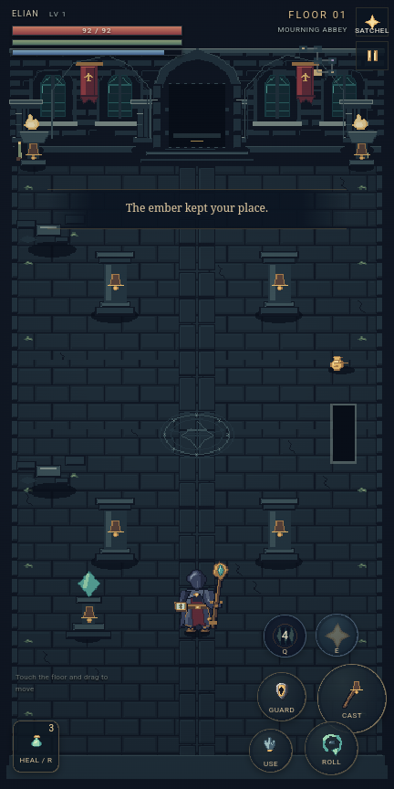

# Vespergrave: The Bell Below

An original, offline portrait action roguelike. Carry the last ember through **100 procedural floors**, ten ruined realms and ten named bosses. All game text defaults to English.

[Download the signed Android APK](releases/Vespergrave-3.0.0.apk?raw=true) · [Android build instructions](android/README.md) · [Editable Aseprite sources](art)



## The descent

- **Three heroes:** Aldric, a plate-armoured knight with a pointed longsword and shield; Sera, a hooded dual-dagger hunter; and Elian, a weathered sorcerer with layered robes, a grimoire and carved staff.
- **Ten biomes:** Mourning Abbey, Drowned Reliquary, Thornwake Grove, Cinderforge, Ivory Necropolis, Frostveil Bastion, Scarlet Catacombs, Astral Archive, Gilded Ruin and The Bell Below.
- **Sixty enemy designs**, including a boss on every tenth floor. Enemy behaviours include committed charges, thrusts, melee sweeps, arrows, spell volleys, slams, roots, summons and meteor attacks. Bosses accelerate their patterns below half health.
- Eight seeded floor plans with branching routes and loops. Six or seven rooms use different architecture on each floor: processional halls, cloisters, shattered bridges, crypts, cisterns, galleries, arenas, crossings, archives, root sanctuaries, foundries and ritual courts. Each chamber fits the portrait screen; a small map shows its connections.
- **Ten interactive events:** a blood altar, cursed coffer, wounded pilgrim, oath shrine, sealed manuscript, falling-star vault, wandering smith, mirror champion, three-wave bell and a memory bargain. Choices consume actual resources, grant run-long boons, or begin encounters with earned rewards. Trials and choices persist through Continue.
- Stamina, directional guard, dodge invulnerability, three-strike primary attacks, sorcery projectiles, focus, healing flasks, nine class skills, two equipped skill slots and skill strengthening.
- **One hundred named base item designs**, with seeded level, rarity, affixes and numerical rolls. Six equipment slots, inventory, consumables, purchase and salvage.
- Original splash and app icon, three onboarding pages, an interactive six-step practice chamber, five illustrated opening scenes, a choice of two endings, English narration, captions, an original ambient score and sound effects.
- New Game, Continue, settings, equipment, skills, bestiary, journal, About, Share and a private in-app rating. Autosaved active runs and permanent ember bonds persist on the device.

The Rate page records a local rating and links to project feedback. A public store listing has not been published. Share opens Android's share chooser, the browser share sheet, or a copy-link fallback after the player's action.

## Play

Open `index.html` directly, or run `npm start` and visit `http://127.0.0.1:4173/`. All art, animation metadata, narration and logic are embedded in the HTML. No account or runtime network connection is required.

Touch and drag any open floor to reveal the floating eight-way D-pad. Its base follows a long drag. Release hides it; the next touch chooses a new origin. Movement, held attacks, guard and one-shot actions accept independent fingers. The game fills the phone viewport, including when its height changes.

| Keyboard | Action |
|---|---|
| WASD / arrows | Move and face |
| J | Hold primary attack / cast |
| K | Hold guard |
| Space | Dodge roll |
| Q / E | First / second equipped skill |
| R | Drink healing flask |
| F | Use a nearby door, event, chest, hearth, keeper or stair |
| I | Equipment, skills and journal |
| Escape | Pause or close a page |

`atelier.html` is a standalone gallery of all 63 characters. Choose a character, facing and animation, or pause the preview. The in-game bestiary also previews every enemy's idle, walk and attack.

## Pixel artwork

Graphics are drawn as native pixel clusters, keyed poses and drawing primitives through **MCP Aseprite**. The layered `.aseprite` documents are editable. Character frames are redrawn from authored keys; they are not generated by rotating or stretching a portrait. Large enemies use their own native resolution.

| Character set | Native cell | Frames |
|---|---|---:|
| Each of three heroes | 96 × 96 | 240 |
| Ordinary enemies | 96 × 96 | 128 each |
| Bosses and brutes | 144 × 112 | 128 each |
| Total character frames | Four facings | 8,400 |

Elian has independently designed hood, face, mantle, sleeves, split robe, belt, boots, grimoire, staff, casting, dodge and fallen poses. Enemy heads replace the original head rather than being layered above it. Native-size neck, shoulder and pelvis masses connect the body parts. The cast includes quadrupeds, spiders, a leech, moths, living books, stone and bone constructs, a mounted marshal and other distinct boss silhouettes. Wraiths and winged creatures deliberately hover; other actors retain a common foot plane and contact shadow.

The individual review covers **60 enemies in 540 key poses**, with Aseprite-exported opaque-pixel paths from head to torso. It found and corrected disconnected anatomy, then passed with zero remaining connectivity failures. Filmstrips and onion-skin views supplement the numerical checks. These checks do not substitute for artistic judgement.


Other assets include ten 360 × 640 room illustrations, 40 architectural headers, 160 biome-specific floor and furnishing tiles, ten large arena seals, 80 original furnishing variants, ten event objects and ten event illustrations, 100 item icons, nine skill icons, six cinematic panels, animated flames, touch icons and the launcher artwork. Atlas packing keeps every texture below 4096 pixels on either edge. Enemy atlases from earlier biomes are released from the image cache as the descent advances.


[Compare the twelve rooms on Android](previews/level-gallery.html). Bridge and cistern banks grow to fit the viewport while retaining the original pixel size.

## Narration

Thirty English clips are bundled offline. Deepgram Aura 2 voices Draco, Pandora and Orpheus read the original script in `game/content.mjs`. Voice volume and captions are available in settings. `assets/vo/manifest.json` records text, voice, length and SHA-256 for each clip.

To regenerate narration, set `DEEPGRAM_API_KEY` only in the build environment and run `node tools/generate-vo.mjs`. The key is not included in the game, APK, source files or manifest. Existing matching clips are reused.

## Build and verify

Node.js 20.11+ is required; the web game has no npm dependencies.

```sh
npm run build
npm test
npm start
```

The checks cover all 100 floors under four seeds, room graph reachability and reciprocal doors, eight route plans and twelve distinct room layouts, furnishing routes at four viewport heights, event costs and one-time rewards, multi-wave encounters, timed trial warnings and persistence, progression to the ending, actual primary combat, guard, dodge, every boss pattern, all nine skills, equipment, item rolls, revisiting rooms, saves, tutorial controls and death. The shipping renderer is exercised with every one of the 8,400 source frames. Touch tests cover independent pointers and one-shot skill/heal input.

Android instrumentation verifies the actual offline WebView, English UI, full portrait viewport, opening audio playback, floating movement, simultaneous attack, cancellation, mage skill, equipment, animated bestiary, settings persistence, Continue after activity recreation and responsive resizing. A second test previews all twelve room layouts, chooses an event boon, starts the bell waves and verifies a timed trial through pause and Continue. Reports and screenshots are in `previews/android-vespergrave/`. Room/event preview fixtures place the player directly at the feature being reviewed.

```sh
node tools/mcp-service.mjs
npm run art
node tools/package.mjs
```

Art regeneration needs the local MCP bridge and Aseprite. The original installation is `C:/Isprite Asset/aseprite-ai-artist` with `C:/Isprite Asset/tools/aseprite-build/bin/aseprite.exe`. Adapt the local paths on another machine. A headless session was intentionally chosen for batch drawing. `art/provenance.json` contains operation counts and output hashes; the full local audit log is excluded from delivery.

## Project files

- `game/content.mjs`: the complete English catalogue, lore and narration script.
- `game/campaign.mjs`: generation, combat, progression, equipment and validated saves.
- `game/presentation.mjs`, `game/campaign.css`: portrait renderer, input, menus, cinematic and audio.
- `tools/draw-campaign-*.mjs`, `tools/mage-design.mjs`: reproducible MCP drawings and animation keys.
- `art/`, `assets/`: editable documents, final atlases, frame tags, native foot anchors and offline audio.
- `previews/cast-anatomy-report.json`, `campaign-asset-report.json`, `campaign-test-report.json`: verification evidence.
- `android/`: offline Android host, Gradle project and instrumentation test.
- `releases/Vespergrave-3.0.0.apk`: signed universal release for Android 8.0+.

The Android package and signing certificate are retained from Cinder Vow so this release can update version 2.2.0. Earlier slice sources and releases remain as project history. Vespergrave's shipped game uses the campaign engine.

The pixel5x7 bitmap font supplied by Aseprite AI Artist's font knowledge is CC0-1.0. Vespergrave's lore, characters, illustration and score are original; third-party game artwork and music are not included.
