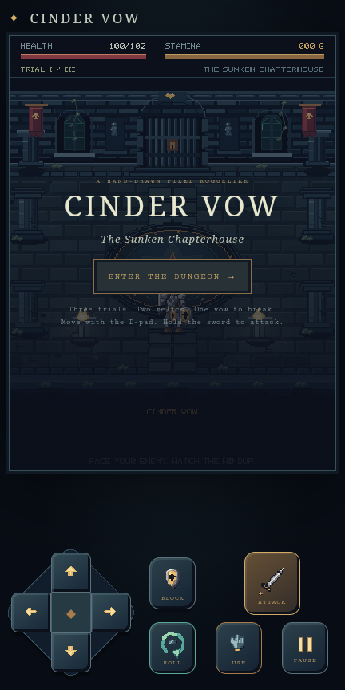
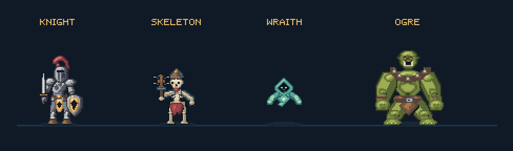

# Cinder Vow — The Sunken Chapterhouse

A hand-authored pixel action roguelike, with a desktop browser version and an offline **portrait Android APK**. English is the default throughout the game, animation viewer and Android application.

[Download the Android APK](releases/CinderVow-2.1.0.apk?raw=true) · [Android build instructions](android/README.md) · [Editable Aseprite sources](art)



## Play

Open `index.html` directly, or run `npm start` and visit `http://127.0.0.1:4173/`. The HTML bundles the art, animation metadata, bitmap font and game logic. No runtime internet connection is needed.

For the portrait browser layout, use `http://127.0.0.1:4173/?mobile=1`. Portrait touch devices select this layout automatically. The Android app always opens it in portrait. Its following camera keeps the original pixel proportions, with the D-pad and action buttons below the play area.

Open `atelier.html` to inspect all characters, facings and animations. The viewer offers pause, slow playback and individual frame stepping.

| Desktop | Action |
|---|---|
| WASD / arrows | Move and face |
| J / Space / left click | Hold for crosscut → backhand → heavy combo |
| Shift / K | Dodge roll |
| L / right click | Hold to block |
| Mouse | Aim; movement determines facing without the mouse |
| E | Use the chest, shrine or north exit |
| P / Esc | Pause |
| 1 / 2 / 3 | Choose a relic |
| Enter | Start or restart |

On Android, use the eight-direction D-pad, sword, shield, roll arrow and hand buttons. Movement and actions accept separate simultaneous fingers. Pointer cancellation, pause and backgrounding release held inputs. The pause menu includes sound control.

## Artwork

Every game sprite, architectural prop, flame, control icon and launcher icon is authored as pixel grids and drawing primitives through **Aseprite AI Artist MCP 0.8.2**, using Aseprite **1.3.18.6-dev**. Editable layered sources are included. Art generation deliberately uses a headless Aseprite session for batch assets.

The knight has a ventilated great helm, red plume, gorget, layered plate armour, gold tabard, articulated knees and greaves, leather boots and a bevelled heater shield. The longsword uses two steel planes, a brass crossguard and a triangular point that tapers to one pixel. The same construction follows its keyed attack poses.

The enemies contrast in silhouette and movement: a rust-helmeted skeleton with exposed ribs and a spiked wooden club, a hooded spectral caster, and a broad olive ogre with tusks, scars, leather wraps and heavy fists. Walks use contact, down, passing and lift poses. Attacks have anticipation, impact and recovery. Feet, hands and held equipment remain connected.

| Character | Cell | Frames | Clips |
|---|---|---:|---|
| Knight | 96×96 | 240 | Four facings × idle 4, walk 8, crosscut 9, backhand 9, heavy 9, roll 6, block 4, hurt 4, death 7 |
| Skeleton / hollow | 96×96 | 128 | Four facings × idle 4, walk 8, attack 9, hurt 4, death 7 |
| Ogre / warden | 144×112 | 128 | Four facings × idle 4, walk 8, attack 9, hurt 4, death 7 |
| Wraith / wisp | 64×64 | 32 | Idle 4, walk 8, cast 9, hurt 4, death 7 |

There are **528 character frames**, 14 control/relic icons and 10 editable Aseprite sources. The wraith deliberately floats. Grounded actors share a floor contact; the ogre is drawn at its own native resolution.



## The slice

One detailed 640×360 stone hall, with masonry, lancet windows, reliefs, banners, an oath mosaic, ivy, a water trench, tombs, books, shrine, chest and animated braziers. Three encounters lead to the ogre and the north exit. Six relics modify a run, with stamina, combo attacks, blocking, rolling, hitstop, knockback, coins, healing, death and restart. Sound is synthesized locally.

This is one arena with three encounters. Run variation comes from enemy formations and relic choices. It does not yet generate multiple dungeon rooms or save progression between runs.

## Files

- `index.html`: standalone game with desktop and portrait layouts.
- `atelier.html`: standalone animation viewer.
- `releases/CinderVow-2.1.0.apk`: signed universal Android release, Android 8.0+.
- `android/`: Gradle wrapper, native offline WebView host and instrumentation test.
- `art/*.aseprite`: ten editable layered sources.
- `assets/`: PNG atlases, timing, animation tags, pivots and individual UI icons.
- `previews/cast-design.png`: MCP character lineup.
- `previews/knight-sword-detail.png`: pointed sword close-up.
- `previews/*-detail.png`, `*.gif`, `*-attack-film.png`: character and animation reviews.
- `previews/anchor-report.json`: actual exported-pixel contact and connection checks.
- `previews/verification.json`: gameplay checks and three complete seeded runs.
- `art/provenance.json`: MCP operation counts and asset checksums.
- `references/`: local reference images and the design features adapted from them.
- `game/`, `tools/`: authored pixel drawings, game source, build and verification tools.

Untrimmed pivots: knight/skeleton `(48,76)`, ogre `(64,96)`, wraith `(32,58)`, props `(32,70)`. JSON atlas indices begin at zero; MCP frame numbers begin at one.

## Build and test

Requires Node.js 20.11 or newer for source builds; no npm dependencies are needed for the web game.

```sh
npm run build
npm test
npm start
```

Android requires JDK 17+, SDK platform 35 and Android build tools. See [android/README.md](android/README.md). The release signing key is kept outside this repository. The GitHub Actions workflow verifies the web game and builds a debug APK; the committed release APK is signed separately.

`npm test` checks 496 authored ground contacts, all 412 live grounded body/gear connections, pointed idle swords in four facings, animation tags, combo timing, 13 gameplay cases, multi-pointer touch behaviour and every one of the 528 poses through the shipping renderer. Three ordinary-rule seeded playthroughs complete all encounters and the exit. Android instrumentation verifies real WebView initialization, portrait/English UI, touch bounds, movement, two-pointer input, cancellation and pause.

MCP review checks palette, layers, animation, export readiness, stray pixels and effect placement. There are no errors. Style notes about outlines on individual material layers are accepted: metal, cloth, bone and glow use selective edges, while the composite structure is checked separately. Attack filmstrips and onion skins are reviewed visually; automatic scores are not treated as a measure of artistic taste.

To regenerate art on the original machine, run `node tools/mcp-service.mjs`, then `npm run art` and `node tools/export-previews.mjs`. The MCP checkout is at `C:/Isprite Asset/aseprite-ai-artist`, and Aseprite is at `C:/Isprite Asset/tools/aseprite-build/bin/aseprite.exe`. Adapt those paths for another machine. The complete session audit stays local at `art/mcp-audit.jsonl` and is excluded from Git and delivery archives.

The `pixel5x7` bitmap font comes from Aseprite AI Artist's font knowledge, CC0-1.0. Reference images were found in the user's local asset folder; game sprites are newly authored at game resolution, rather than resized reference portraits.
